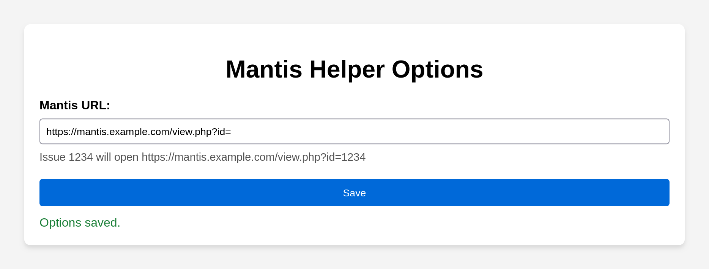
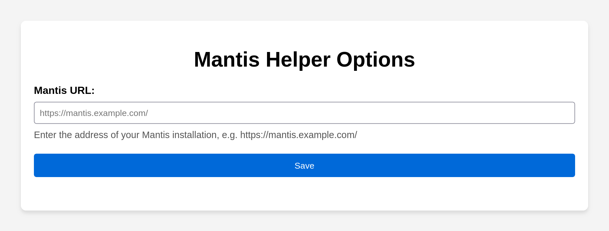
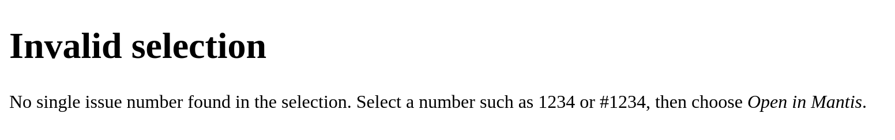

# Mantis Helper — Firefox, Chrome and Edge Extension

A browser extension for users of the [Mantis](https://www.mantisbt.org/) bug tracker: select an issue number on any web page, right-click, and the issue opens in Mantis. One code base for Firefox, Chrome and Edge.



**Status:** current version v2.1.1 ([changelog](#changelog)). More screenshots, in Firefox and Chrome: [the gallery](docs/screenshots/README.md).

Get it from [Firefox Add-ons](https://addons.mozilla.org/firefox/addon/mantis-helper/), [Microsoft Edge Add-ons](https://microsoftedge.microsoft.com/addons/detail/lonfhapelejfelckobbncbdihemjnnjk) or the [Chrome Web Store](https://chromewebstore.google.com/detail/mantis-helper/ooojdplmloiglcdeenklfcjaimcboenp).

## Features
- **Context Menu Integration:** Select an issue number on any webpage, right-click, and choose **Open “…” in Mantis**. The menu shows the selected text.
- **Opens Beside the Current Tab:** the issue opens in a new tab next to the current one, in the same tab group (and in Firefox the same container).
- **Finds the Number in the Selection:** `1234`, `#1234`, `0001234` and selections like `Issue #1234:` or `0001234: Fix login bug` all open issue 1234.
  - Several numbers: a `#` number wins, then a zero-padded one like Mantis displays them.
  - Otherwise the selection is ambiguous and a hint page opens.
- **Simple Configuration:** Enter the address of your Mantis installation (e.g. `https://mantis.example.com/`) and `view.php?id=` is appended automatically.
  - Pasting a Mantis page or issue link works too.
  - URLs with a query string (e.g. `https://mantis.example.com/view.php?id=`) are used as they are.
  - The options page shows which address an issue number will open.

## Permissions
The extension requires the following permissions:
- **Context Menus** — To add **Open “…” in Mantis** to the browser's right-click menu.
- **Storage** — To save the Mantis URL that you set in the options. If you use Firefox Sync for add-ons, or Chrome or Edge sync, it is synced too.

**Data collection:** none. Mantis Helper sends nothing to its developer or anyone else. When you choose **Open “…” in Mantis**, the selected number is opened as a link on the Mantis server you configured. See [PRIVACY.md](PRIVACY.md).

## How to Use
1. **Install** the extension from [Firefox Add-ons](https://addons.mozilla.org/firefox/addon/mantis-helper/) (Firefox 142 or later), [Microsoft Edge Add-ons](https://microsoftedge.microsoft.com/addons/detail/lonfhapelejfelckobbncbdihemjnnjk) or the [Chrome Web Store](https://chromewebstore.google.com/detail/mantis-helper/ooojdplmloiglcdeenklfcjaimcboenp) (Chrome or Edge 99 or later).
2. **Configure** your Mantis URL: open the extension's options (Firefox: Add-ons and themes, `about:addons` > Mantis Helper > Options; Chrome and Edge: Extensions > Mantis Helper > Extension options) and enter the address of your Mantis installation. If you use the menu entry before configuring it, the options open automatically.

   
3. **Use it:** Highlight an issue number (e.g. `1234` or `#1234`) on a webpage, right-click, and select **Open “…” in Mantis**. If the selection holds no single issue number, a hint page opens instead:

   

To use it in private windows, allow "Run in Private Windows" for Mantis Helper in `about:addons` (Firefox), or turn on "Allow in Incognito" (Chrome) or "Allow in InPrivate" (Edge) in the extension's details.

## Development
One source tree for both browsers: `data/` (the scripts call `chrome.*`, which Firefox offers too), `icons/`, and `manifest.json` with what both share plus `manifest.chrome.json` and `manifest.firefox.json` for the rest (background, options page, browser settings). `scripts/build.mjs` merges them into one unpacked extension per browser.

Run `npm ci` once (Node 26, as in CI), then:
- Build: `npm run build` writes `dist/chrome/` and `dist/firefox/` (unpacked) and the store packages `dist/mantis-helper-chrome-<version>.zip` (Chrome Web Store, Edge Add-ons) and `dist/mantis-helper-firefox-<version>.zip` (addons.mozilla.org). `node scripts/build.mjs` alone rebuilds the unpacked ones.
- Lint: `npm run lint` — ESLint (`eslint.config.mjs`), then `web-ext lint` on `dist/firefox`, the validator addons.mozilla.org runs on upload (warnings fail it, as in CI)
- Unit tests for the selection and URL parsing in `data/mantis.js`: `npm test`
- Try it out after a build: in Firefox open `about:debugging#/runtime/this-firefox`, click "Load Temporary Add-on…" and select `dist/firefox/manifest.json` (or run `npx web-ext run -s dist/firefox`); in Chrome or Edge open `chrome://extensions` or `edge://extensions`, turn on Developer mode, click "Load unpacked" and select `dist/chrome`.

A release bumps `version` in `manifest.json` (one version for both browsers) and adds its changelog entry, in a commit of its own (`Release x.y.z: …`).

CI (`.github/workflows/ci.yml`) runs the lint and unit tests, builds both packages (artifacts `mantis-helper-chrome` and `mantis-helper-firefox`), and runs the docs tours and the e2e suites in both browsers on every push to `master` and every pull request.

## E2E
Two suites, one per browser, each against its built package (`scripts/e2e.sh` builds first). No server, no Docker.
- **Firefox** ([`e2e/firefox/`](e2e/firefox/), inventory [`COVERAGE.md`](e2e/firefox/COVERAGE.md)): `dist/firefox` is installed as a temporary add-on over Firefox's remote debugging protocol (as `web-ext run` does). The suite calls the menu's click handler with a real page's selection and tab, and checks what opens where. The options page is driven as a file with a stubbed `chrome` API.
- **Chrome** ([`e2e/chrome/`](e2e/chrome/), inventory [`COVERAGE.md`](e2e/chrome/COVERAGE.md)): `dist/chrome` is loaded unpacked into a fresh headless Chromium profile per test, which drives the options page, the hint page and the context menu's click handler (the menu itself is browser UI).

```bash
cd e2e && npm ci && npx playwright install --with-deps firefox chromium && cd ..
scripts/e2e.sh firefox                 # extra arguments go to Playwright, e.g. tests/menu.spec.ts
scripts/e2e.sh chrome                  # e.g. -g options
```

## Screenshots
The images in [`docs/screenshots/`](docs/screenshots/README.md) (`firefox/` and `chrome/`) are taken by the docs tours in `e2e/firefox/docs/` and `e2e/chrome/docs/`. Playwright cannot load an extension into Firefox, so the Firefox tour opens the pages of `dist/firefox` as files and stubs the `chrome` API they use; the Chrome tour loads `dist/chrome` into headless Chromium. They need no server and no Docker:

```bash
cd e2e && npm ci && npx playwright install --with-deps firefox chromium && cd ..   # --with-deps: also the system libraries (sudo)
scripts/docs-screenshots.sh            # writes docs/screenshots/<browser>/*.png; pass a directory (and a browser) to write elsewhere
```

The **Docs screenshots** workflow (manual) runs the same script and uploads the PNGs as the `docs-screenshots` artifact; it never commits. Chromium shows the extension's own pages in the host's UI font where they set no font (the invalid-selection page), so a local run can differ there from the committed PNGs, which come from that workflow.

## Changelog
Up to v2.1.1 (Firefox) and v2.0.3 (Chrome and Edge) the two browsers had their own repositories and versions; the next release is one version for both.

### Firefox

#### v2.1.1
Fixed:
- Text typed into the options page right after it opened could be wiped when the saved URL finished loading, and Save then did nothing.

#### v2.1.0
Fixed:
- The options page could not be scrolled to its top when the window was lower than the form (e.g. zoomed in).
- The Save button's text and the URL field's border had too little contrast.

Changed:
- Requires Firefox 142 or later, the first version with the built-in data consent on every platform (Firefox ESR 140 reached its end of life in September 2026).

#### v2.0.1
Fixed:
- The "Open in Mantis" menu entry disappeared after every Firefox restart.
- Selecting a `#`-prefixed issue number (e.g. `#123`) opened the error page.
- Values such as `1e3`, `0x1A`, `-5` or `1.5` were accepted as issue numbers.
- Unusable Mantis URLs (e.g. without `https://`) opened broken tabs; the options page now rejects them, and an unconfigured extension opens its options instead of example.com.

Changed:
- Migrated to Manifest V3; requires Firefox 140 or later.
- Declares in the manifest that no data is collected (Firefox's built-in data consent).
- The Mantis URL can be the base address of the installation; URLs without a query string are now treated as such, and `view.php?id=` is appended.
- The issue number is found within the selected text, and the menu shows the selection.
- New tabs open next to the current tab, in its container and tab group.
- The options page previews the resulting address and confirms saving inline instead of with a pop-up.

Version 2.0.0 was an unreleased build.

#### v1.2.0.0
- Opens an error page when the selection is not a number.
- Removed the toolbar button.

#### v1.1.0.0
- Reorganized the files, added icon sizes, README and license.

#### v1.0.0.0
- Initial release (Manifest V2).

### Chrome and Edge

#### v2.0.3
Fixed:
- The Save button's text and the URL field's border had too little contrast.
- Text typed into the options page right after it opened could be wiped when the saved URL finished loading, and Save then did nothing.

#### v2.0.2
Fixed:
- The options page could not be scrolled to its top when the window was lower than the form (e.g. zoomed in).

#### v2.0.1
Fixed:
- Selecting a `#`-prefixed issue number (e.g. `#123`) opened the error page.
- Values such as `1e3`, `0x1A`, `-5` or `1.5` were accepted as issue numbers.
- Unusable Mantis URLs (e.g. without `https://`) opened broken tabs; the options page now rejects them, and an unconfigured extension opens its options instead of example.com.

Changed:
- Requires Chrome or Edge 99 or later.
- The Mantis URL can be the base address of the installation; URLs without a query string are now treated as such, and `view.php?id=` is appended.
- The issue number is found within the selected text, and the menu shows the selection.
- New tabs open next to the current tab, in its tab group.
- The options page previews the resulting address and confirms saving inline instead of with a pop-up.

Version 2.0.0 was an unreleased build.

#### v1.2.0.0
- Opens an error page when the selection is not a number.
- Reorganized the files and added icon sizes.

#### v1.0.0.0
- Initial release (Manifest V3).

## License
See [License.md](License.md).
