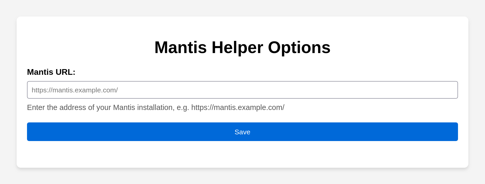
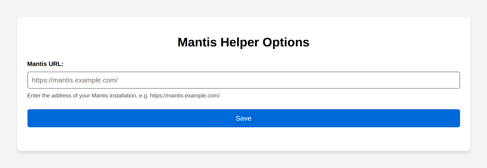
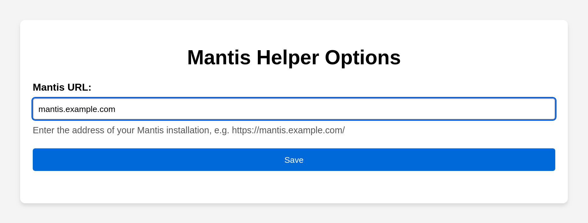
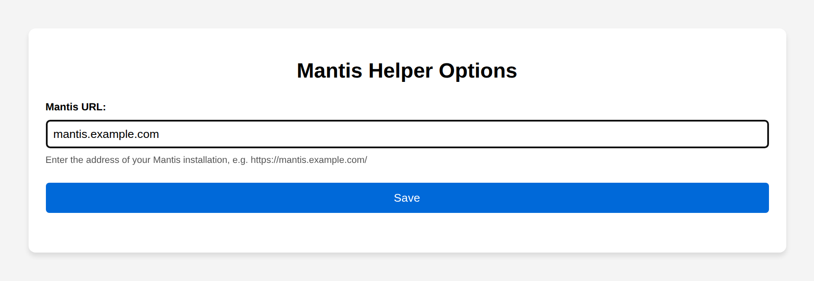
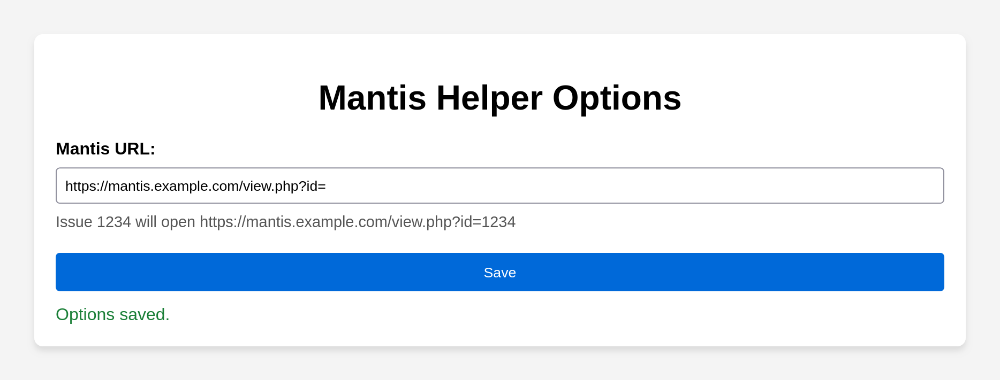
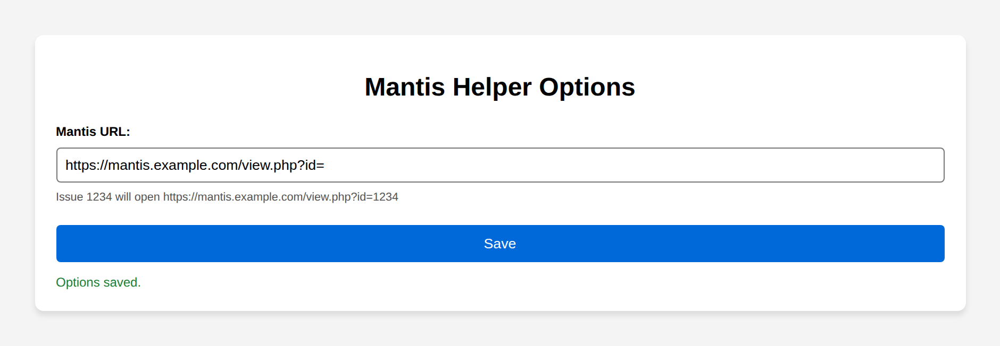
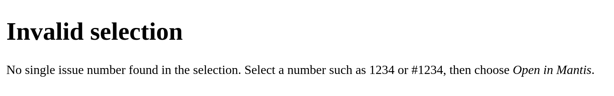
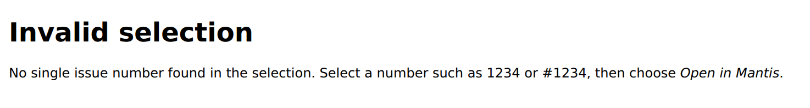

# Screenshots

Every page Mantis Helper shows, in Firefox ([`firefox/`](firefox/)) and in Chromium for Chrome and Edge
([`chrome/`](chrome/)), with a fictional Mantis address. The pages are the same; the browsers draw the form
controls and fonts their own way. The context menu entry itself (**Open “…” in Mantis**) is browser UI and
cannot be captured. Regenerate the images with `scripts/docs-screenshots.sh` (see the
[README](../../README.md#screenshots)).

## Options: not configured yet

The options page as it first opens, also when "Open in Mantis" is used before a Mantis URL is set. The
line under the field explains what to enter.

## Options: unusable URL

An address without `http://` or `https://` is rejected: the hint stays, and **Save** does not store it.

## Options: saved

After **Save**, the base address has `view.php?id=` appended, the line under the field shows which
address an issue number opens, and "Options saved." confirms it.

## Invalid selection

Opens in a new tab when the selection holds no issue number, or several that are equally likely
(here: “Issues 12 and 34”).

